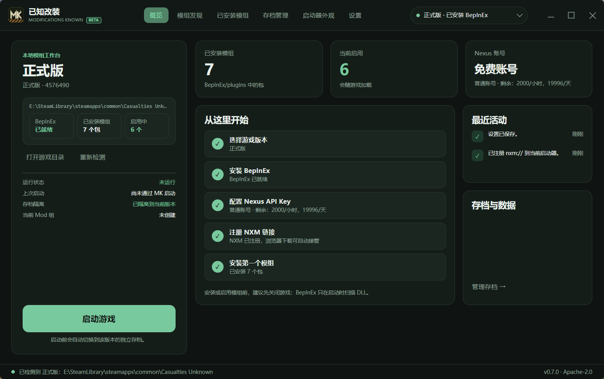
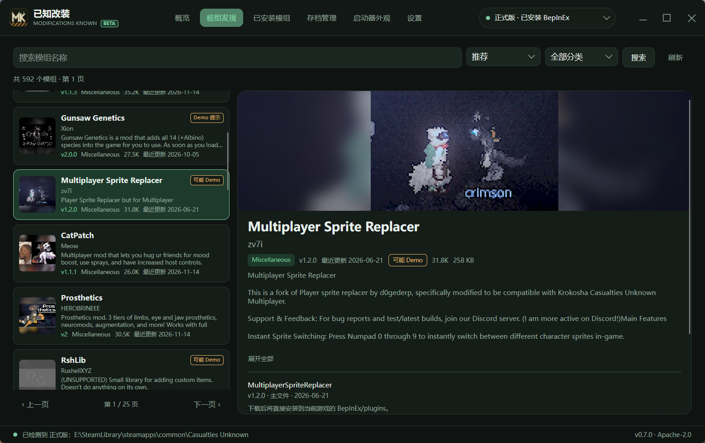
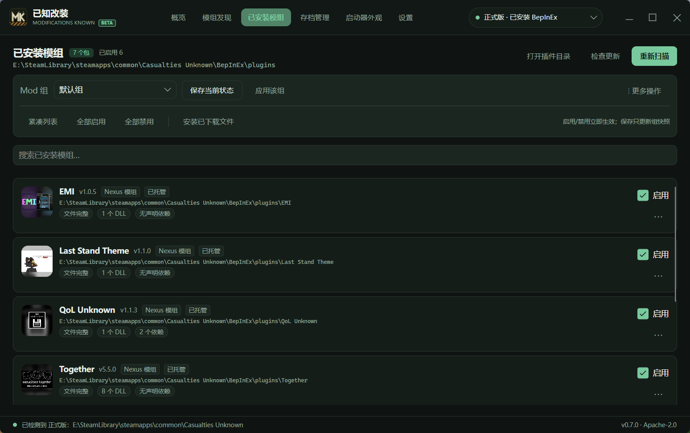
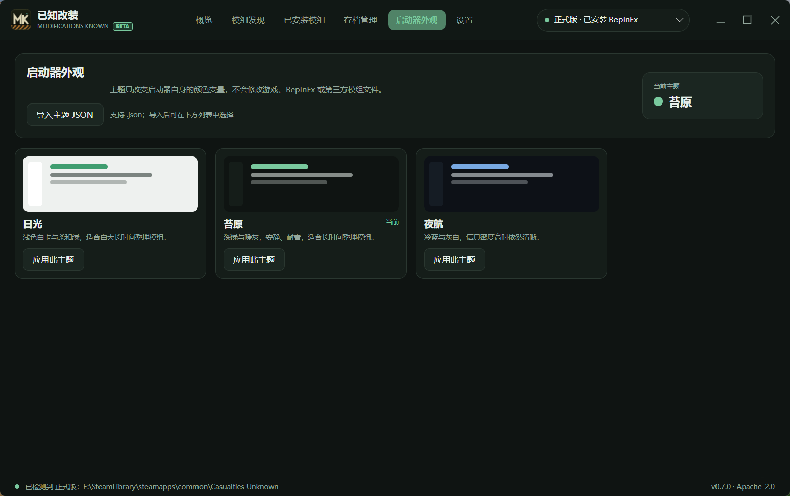
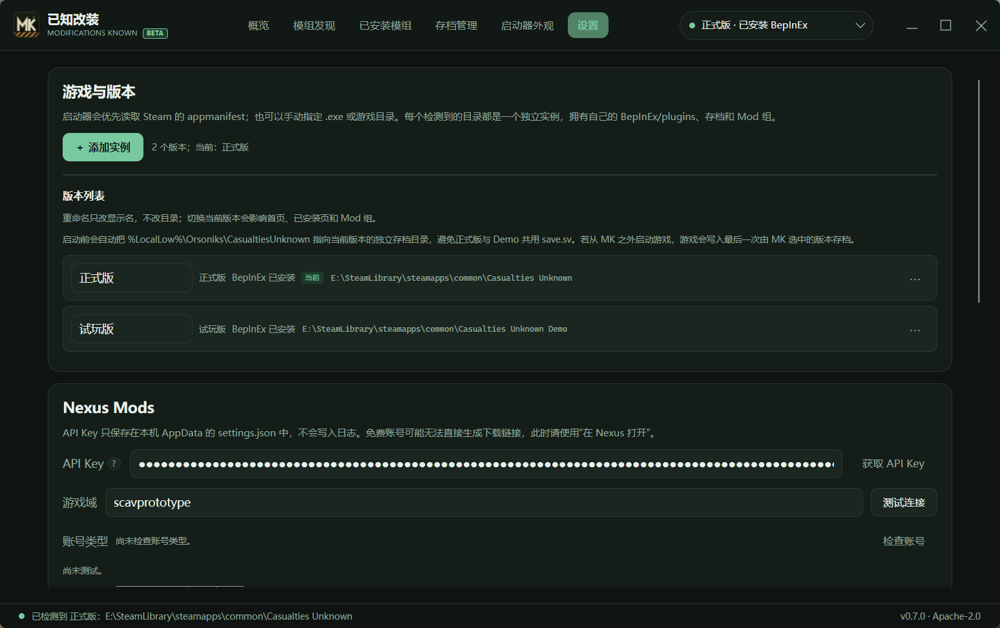

<p align="center">
  
</p>

<h1 align="center">已知改装 · Modifications Known</h1>

<p align="center">
  为《未知伤亡 / Casualties Unknown》打造的本地优先 BepInEx 模组管理器。
</p>

<p align="center">
  
  
  
  
  
</p>

> 一个安静、可靠、可解释的模组管理器：不隐藏文件系统，不静默覆盖，不让免费账号在 403 面前一脸问号。

**当前版本：`0.7.0-beta`** · [下载 Release](https://github.com/HOPE-LGNF/modifications-known/releases/tag/v0.7.0-beta)  
**平台：** Windows 10/11 · **运行时：** .NET 8 · **UI：** Avalonia 11

---

## 目录

- [为什么是 MK](#为什么是-mk)
- [功能](#功能)
- [界面](#界面)
- [快速开始](#快速开始)
- [模组安装与更新](#模组安装与更新)
- [Nexus 与 NXM](#nexus-与-nxm)
- [存档组](#存档组)
- [主题](#主题)
- [启动器更新](#启动器更新)
- [构建](#构建)
- [目录结构](#目录结构)
- [安全边界](#安全边界)
- [已知限制](#已知限制)
- [文档](#文档)
- [许可证](#许可证)

## 为什么是 MK

大多数模组管理器假设用户只玩一个游戏版本、只从一个来源安装、并且愿意接受“安装失败但不知道失败在哪”。

《未知伤亡》的正式版与试玩版会并行存在，BepInEx 模组又经常以“一个文件夹 = 一个包”的形式分发。MK 围绕这两个现实设计：

- **实例是一等公民**：每个游戏目录有自己的 BepInEx、存档组、Mod 组和 Nexus 来源记录。
- **包是操作单位**：多 DLL 模组整体启停、整体卸载，而不是逐个 DLL 猜测。
- **写入可解释**：安装前预检、包内 manifest、哈希校验、失败报告具体到包。
- **本地优先**：配置、日志、缓存、备份都在本机；没有账号后端，也不上传模组文件。

## 功能

### 游戏与实例

- 读取 Steam `appmanifest`，同时识别正式版与试玩版；也支持手动选择 exe/目录。
- 多实例切换：首页、已安装、存档、Mod 组都跟随当前实例。
- 实例别名、重新探测 Steam 库、删除实例（存档组保留在 AppData，不会被复制或删除）。
- 启动检测：Steam 实例走 `steam://`，非 Steam 实例直接启动自己的 exe。
- 运行状态监控；可选“阻止单实例多开”，运行中把“启动游戏”切换为红色“关闭游戏”。

### BepInEx 与模组

- 扫描 `BepInEx/plugins`，递归识别嵌套 DLL，按目录归包。
- 启用/禁用整个包，支持混合状态提示。
- 包内 `.modifications-known/manifest.json` 记录来源、版本、文件哈希。
- 按清单卸载只删除未修改的托管文件，保留用户新增/修改的文件。
- 未托管的旧包可“接管”，生成基线清单。
- **卸载 BepInEx**：两步危险确认 + 5 秒最终倒计时，同时删除该实例全部模组、插件与配置。
- 安装/卸载写入按实例串行化，避免并发冲突。

### Nexus 与更新

- Nexus v3 搜索、详情、文件/版本、下载与安装。
- 免费账号 403 时给出可读提示，并提供浏览器/NXM 回退。
- **检查更新**：对已关联 Nexus 的包取“最新文件 + 最高版本”，显示“可更新 vX”徽标。
- **单项更新 / 一键更新**：下载新版本、可选备份旧包、失败恢复旧目录。
- 更新来源与安装结果共享缓存，避免“检查说有更新、更新却说已是最新”。
- 更新完成后自动清除徽标，无需再手动检查。

### 外观与体验

- 苔原（默认）/ 日光 / 夜航三套主题，全部通过 `DynamicResource` 切换。
- 导入 JSON 自定义主题。
- 自绘标题栏、可滚动标题标签、拖动排序与拖放安装。
- 状态栏 Toast、最近活动、首页清单引导。
- 发现页标注“可能 Demo / 作者提到 Demo”，长标题不会遮住提示徽标。

## 界面

### 概览

<p align="center">
  
</p>

当前实例、BepInEx 状态、模组数量、存档隔离、启动按钮和最近活动集中在一页。

### 模组发现

<p align="center">
  
</p>

左侧结果列表，右侧详情；显示最近更新日期、文件版本与 Demo 提示。

### 已安装模组

<p align="center">
  
</p>

按包展示托管状态、DLL 数量、依赖摘要、启用开关和更多操作；顶部支持检查更新与一键更新。

### 启动器外观

<p align="center">
  
</p>

主题只改启动器颜色变量，不会修改游戏、BepInEx 或第三方模组文件。

### 设置

<p align="center">
  
</p>

实例管理、Nexus API Key、游戏域、日志/数据目录、NXM 注册、启动器更新。

## 快速开始

### 使用发布版

1. 从 [GitHub Releases](https://github.com/HOPE-LGNF/modifications-known/releases/tag/v0.7.0-beta) 下载 `win-x64` 单文件 exe；GitHub 无法访问时可用 [蓝奏云镜像](https://unauthhope.lanzout.com/iYnH04g2143g)（密码 `f1ka`）。
2. 启动 MK，在“设置 → 游戏与版本”添加游戏实例。
3. 在实例的 `⋯` 菜单安装 BepInEx。
4. 在“设置 → Nexus Mods”填入 API Key，按需注册 NXM。
5. 到“模组发现”浏览、下载、安装；到“已安装模组”启停或更新。

直接下载：

```text
https://github.com/HOPE-LGNF/modifications-known/releases/download/v0.7.0-beta/ModificationsKnown-v0.7.0-beta-win-x64.exe
```

SHA-256：

```text
aeba515098bd8f1318362efd9a664d85ba9093227351819b7c6adb90cb3d54f0
```

需要控制台日志时：

```powershell
.\ModificationsKnown-v0.7.0-beta-win-x64.exe --console
```

### 从源码运行

要求：Windows 10/11、.NET 8 SDK、已安装游戏与 BepInEx 5。

```bash
dotnet restore
dotnet build
dotnet run --project src/ModificationsKnown.App -- --console
```

测试：

```bash
dotnet test
```

发布单文件：

```bash
dotnet publish src/ModificationsKnown.App -c Release \
  -r win-x64 --self-contained true \
  -p:PublishSingleFile=true
```

## 模组安装与更新

### 安装

- 压缩包先在临时目录解压，校验路径后按包提交。
- 已存在的包不会静默覆盖；目标是“更新”时走单独的版本检查与备份流程。
- 支持从 Nexus 直接下载，也支持“浏览器下载 + 安装已下载文件”和 NXM。

### 更新

- 已安装页“检查更新”只检查已关联 Nexus 的包，手动触发。
- 版本比较以 **Nexus 最新文件版本** 为准，而不是模组页展示版本。
- 单项更新与一键更新都会：
  1. 先确认版本确实更高；
  2. 将旧包移到同盘暂存目录（支持跨卷备份）；
  3. 可选复制一份备份到 `%APPDATA%\ModificationsKnown\backups`；
  4. 安装失败时恢复旧目录。
- 免费账号拿不到直链时，会打开带 `file_id` 与 `nmm=1` 的 Nexus 文件页。

备份目录不会自动清理；确认新版本稳定后可手动删除旧备份。

## Nexus 与 NXM

- API Key 只保存在本机 `%APPDATA%\ModificationsKnown\settings.json`，不会写入日志。
- 浏览公开数据可匿名；文件列表和下载链接通常需要 API Key。
- 免费账号可能无法通过 API 获得直链，这不是 MK 能绕过的限制。
- 注册 NXM 后，浏览器文件页的“Mod manager download”会通过 `nxm://` 回到 MK。
- 未注册 NXM 且非 Premium 时，下载/更新前会提示注册，并附带“NXM 是什么？”说明。
- 单实例运行：MK 已启动时，新的 NXM 会转发到当前窗口，并保持当前页面不跳转。

API 文档：<https://api-docs.nexusmods.com/>

## 存档组

每个游戏目录可以有多个完整的存档组。MK 把 `%LocalLow%\Orsoniks\CasualtiesUnknown` 做成 NTFS junction，指向 `%APPDATA%\ModificationsKnown\save-profiles\<安装键>\<组 ID>\`；应用一个组就切换这个 junction。

- **立即保存**：点击某个存档组的「选择存档组」后立即写入该实例的选定组；当前实例同时切换到该组，其他实例只更新选定组。新建、迁移或导入的首个组会自动成为当前组。只读的页面刷新不会抢占别的版本的存档组；切换版本时如果它还没有组，会创建「默认」并接管。
- **切换即同步**：切换顶部「版本」会把正在使用的存档组一起切到该版本上次使用的存档组；目标版本还没有组时会创建「默认」空组，有未托管存档时先问是否导入；游戏运行中实例选择器禁用。
- **未托管存档导入**：弹窗里选择接收版本（列出每个版本的组数）；0 组的版本导入成「默认」，已有组的版本导入成「导入的存档」（重名自动加序号），原目录按情况保留为备份。MK 里还没有的副本，先在设置里添加实例再导入。
- **归属显示**：页面顶部写正在使用的存档组当前归哪个版本的哪个组；每个版本显示选定组，子卡直接显示这个选定组，正在使用的是别处时用一行小字写明。
- **运行即锁定**：只要任一游戏实例在运行，选择、新建、克隆、重命名、导入、导出和删除全部禁用。写操作开始前会重新扫描进程；进程信息不可读时按“正在运行”处理。检查与切换之间仍有毫秒级窗口，从外部 Steam 启动的进程无法被启动器完全约束。
- **首次使用**：检测到旧的单 profile 存档时，可以导入为默认组、新建空组或取消。取消不会改动任何文件；迁移逐文件 SHA-256 校验，旧目录保留为回退副本。
- **删除**：只把组移入 Windows 回收站，不提供永久删除，可从回收站还原。
- **ZIP 备份**：导出 `manifest.json` + `files/`，导入前校验路径、条目、大小和哈希。导入只新建组，不覆盖、不合并、不做格式转换；跨正式版/试玩版或版本不同会二次确认。导出目标不能位于源组目录内。
- **读取真实布局**：QoL 的 `slot_N.sv` + `slot_N.sv.meta` + `qol_slots.json`（`Slots` 数组、`Names` 对象）、原版单槽 `save.sv`、以及未识别扩展名的通用卡；只读，不修改存档文件。
- **难度**：把存档 `runSettings` 与游戏装配里的六个预设逐项对比（预设表取自 `RunSettings.presets`，共 51 个键；官方译名为艰难/轻松/天堂/荒凉/未植入芯片/无尽）。严格模式：必须正好包含全部 51 个键、类型一致且数值一致（浮点容差 0.01）；缺键（旧存档格式）或出现未知键（新版本/模组）都显示“自定义”，不做猜测。旧存档要等游戏用当前版本重新保存一次才会命中预设。
- **角色**：从存档的 `character` 字段读 0/1/2，显示官方短名 Experiment / Milky / Dune；越界值保留原值显示为“未知角色（n）”，小数同样按原值显示；字段缺失的旧存档不占位。
- **资源上限**：归档条目数、单文件与总展开大小、压缩比和解压后的 JSON 大小都有上限；超限会安全失败并清理临时目录，不影响现有组与链接。

## 主题

内置：

| 主题 | 风格 |
| --- | --- |
| **苔原**（默认） | 深绿与暖灰，安静、耐看 |
| **日光** | 浅色白卡与柔和绿，适合白天 |
| **夜航** | 冷蓝与灰白，高信息密度 |

导入自定义主题：设置 → 启动器外观 → 导入主题 JSON。模板见 [docs/themes/aurora.json](docs/themes/aurora.json)。

主题只改变启动器自身的颜色资源，不修改游戏、BepInEx 或模组文件。

## 启动器更新

设置 → 启动器更新：

1. 请求 GitHub `releases/latest`；
2. 解析版本、Release 页和 `win-x64` exe 资产；
3. 与当前程序集版本比较；
4. 读取 GitHub asset 的 **SHA-256 digest**；
5. 下载后校验哈希，匹配才替换；
6. 当前进程退出后由 PowerShell 辅助脚本替换 exe 并重启。

没有 digest 的 Release 不会自动安装，只打开 Release 页，避免下载到损坏/被篡改的文件。

当前未实现：Authenticode 签名校验、差分更新、失败自动回滚。详见 [docs/AUTO_UPDATE.md](docs/AUTO_UPDATE.md)。

## 构建

```text
src/
  ModificationsKnown.Core/           领域模型、接口、路径安全
  ModificationsKnown.Infrastructure/ Nexus、Steam、BepInEx、安装器、存储
  ModificationsKnown.App/            Avalonia UI、ViewModel、主题
tests/
  ModificationsKnown.Tests/          路径安全、安装器、扫描器、API 模型测试
docs/
  ARCHITECTURE.md                    分层与关键决策
  NEXUS_API.md                       API 契约与限制
  AUTO_UPDATE.md                     自动更新设计与实现
  ROADMAP.md                         下一阶段计划
  images/                            README 截图
```

## 安全边界

- 安装、删除、更新目标都做规范化路径校验；压缩包拒绝 `..` 与绝对路径。
- 不静默覆盖已有包；更新需要版本确认，旧包可回滚。
- 删除托管模组默认二次确认；删除整个目录、卸载 BepInEx 是单独危险操作。
- API Key 是本地明文配置，不加密；不要分享 `settings.json`。
- 启动器更新只接受带 SHA-256 digest 的 GitHub 资产；仍建议从官方 Release 下载。

## 已知限制

- Windows 优先；跨平台结构保留，但未做完整验证。
- 依赖解析、冲突图、崩溃归因和游戏内皮肤仍未实现。
- 模组更新是“重新下载并替换”，没有一键更新全部的历史回滚队列。
- 免费账号的 NXM 仍依赖浏览器与 NXM 注册；不是无交互下载。
- 发现页的 Demo 提示基于更新日期和作者文本关键词，属于**提示**，不是兼容性保证。
- 启动器自更新没有代码签名校验、差分更新和自动回滚。
- Nexus API v3 仍被标记为实验性，DTO/端点集中在 `Infrastructure/Nexus/NexusModsClient.cs`。

## 文档

- [架构与关键决策](docs/ARCHITECTURE.md)
- [Nexus API 契约](docs/NEXUS_API.md)
- [自动更新设计](docs/AUTO_UPDATE.md)
- [路线图](docs/ROADMAP.md)
- [搁置事项](docs/DEFERRED.md)

## 许可证

Apache License 2.0。见 [LICENSE](LICENSE) 与 [NOTICE](NOTICE)。

第三方依赖保留各自许可证：Avalonia、CommunityToolkit.Mvvm、SharpCompress。
