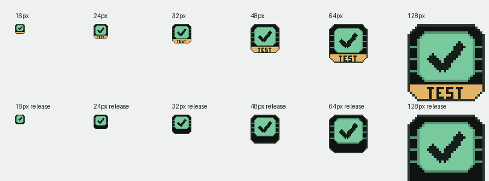

# 已知改装 — 应用图标

像素风应用图标，供启动器本体、窗口标题栏、任务栏与 `nxm://` 协议使用。



## 设计

**芯片 + 勾**。

- **芯片** = 模组。游戏里玩家靠"植入芯片"获得 HUD，摘掉就叫"未植入芯片"；把模组做进芯片里，是这套设定最直接的图形化。
- **勾** = 已知（Known）。与游戏标题"未知伤亡 / Casualties Unknown"构成反义：死亡不可知，改装可清点。
- **琥珀色底带 + TEST** = 测试版。只出现在 `icon-test`，正式版用 `icon-release`（无底带）。

## 配色

全部取自启动器自己的 `ThemePalettes`（`src/ModificationsKnown.App/Theming/ThemePalettes.cs`），不额外引入颜色：

| 用途 | 色值 | 来源 |
|---|---|---|
| 底板 | `#0F1412` | moss `Background` |
| 描边 | `#2A3730` | moss `Border` |
| 芯片 | `#79C99E` | moss `Accent` |
| 芯片描边/引脚 | `#589674` | Accent 压暗 |
| 勾 / TEST 文字 | `#141E1A` | 近黑，保证在薄荷底上可读 |
| 测试带 | `#E5B567` | 三套主题共用的 `Warning` |

薄荷绿与蓝灰的夜航主题相邻时不冲突，与日光/苔原主题同色系，因此**一套图标可以跨三套主题使用**，不需要按主题换图。

## 文件

| 文件 | 用途 |
|---|---|
| `icon-test.ico` | 测试版可执行文件图标（16/24/32/48/64/128/256） |
| `icon-release.ico` | 正式版图标 |
| `icon-test-{16,24,32,48,64,128,256}.png` | 单尺寸 PNG |
| `icon-release-{...}.png` | 单尺寸 PNG |
| `make_icon.py` | 生成脚本（16 与 32 双母版，其余尺寸按整数倍放大） |
| `preview-sizes.png` | 各尺寸预览 |
| `taskbar-dark.png` / `taskbar-light.png` | 深/浅色桌面下的窗口与任务栏 mock |

**16px 是单独手绘的**：去掉引脚与文字，只保留芯片、勾和色带。24/48 由 32px 母版缩放，32 以上为整数倍最近邻放大。

## 集成

### 1. 可执行文件图标

在 `src/ModificationsKnown.App/ModificationsKnown.App.csproj` 的 `PropertyGroup` 里加：

```xml
<ApplicationIcon>..\..\assets\branding\icon-test.ico</ApplicationIcon>
```

切正式版时改成 `icon-release.ico`。

### 2. 窗口图标（Avalonia）

```xml
<Window ... Icon="/Assets/icon-test-32.png">
```

并在 csproj 里把 PNG 作为 Avalonia 资源：

```xml
<ItemGroup>
  <AvaloniaResource Include="..\..\assets\branding\icon-test-32.png" Link="Assets\icon-test-32.png" />
</ItemGroup>
```

### 3. `nxm://` 协议图标

`NxmProtocolRegistrar` 写 `DefaultIcon` 时指向 `.ico` 路径即可（例如 `Path.Combine(AppContext.BaseDirectory, "icon-test.ico")`）。

## 重新生成

```bash
python3 assets/branding/make_icon.py
```

依赖 Pillow。脚本无外部资源，颜色与尺寸都写在文件顶部，改色只需动常量。

## 版本策略建议

- `0.x` / `-preview` 构建 → `icon-test.ico`
- 首个稳定版起 → `icon-release.ico`
- 两者结构完全一致，只差底部琥珀带，用户升级时不会觉得换了产品
