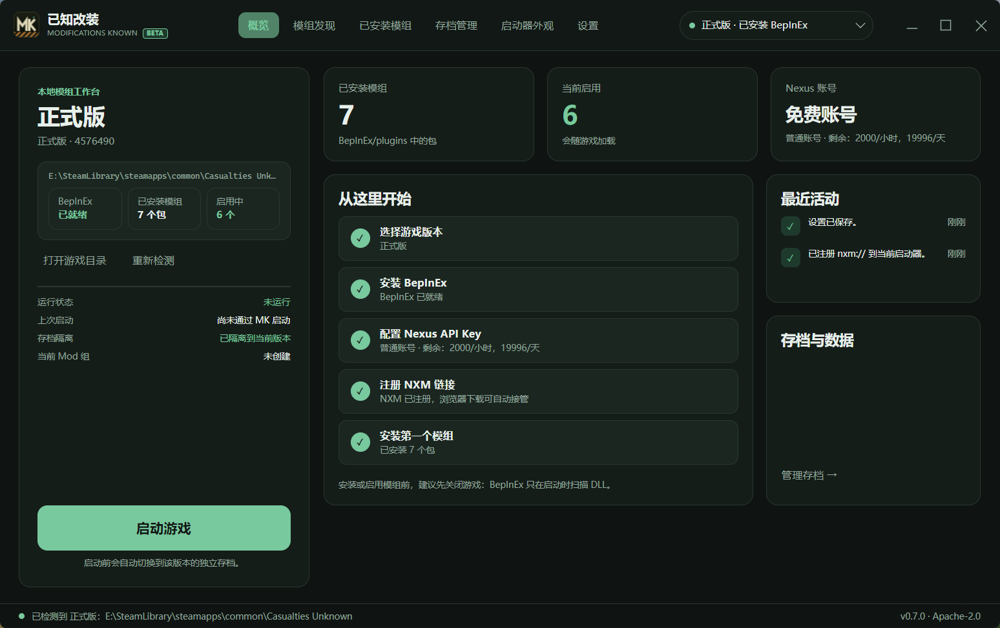
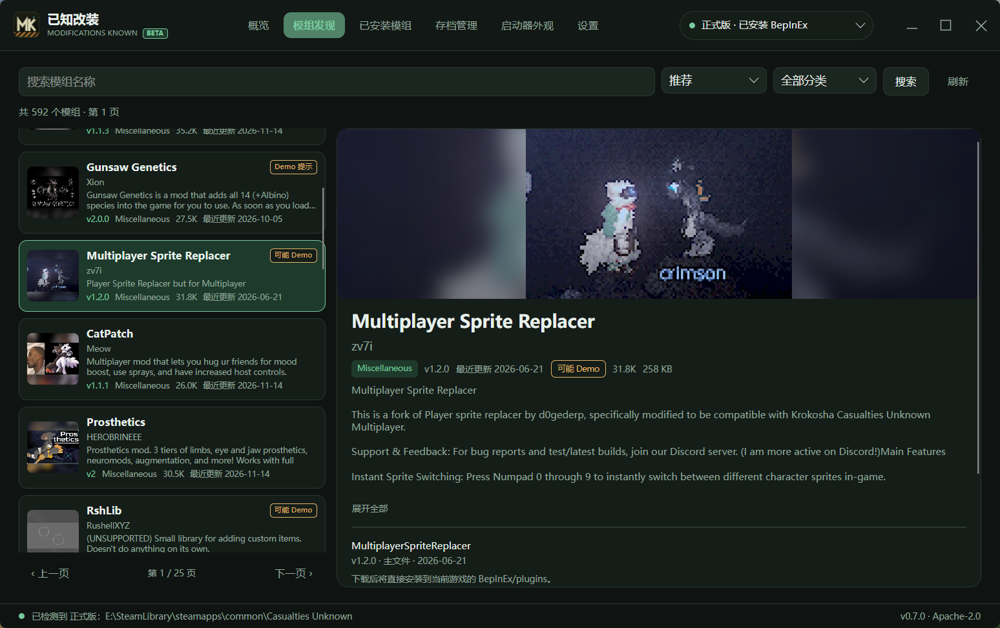
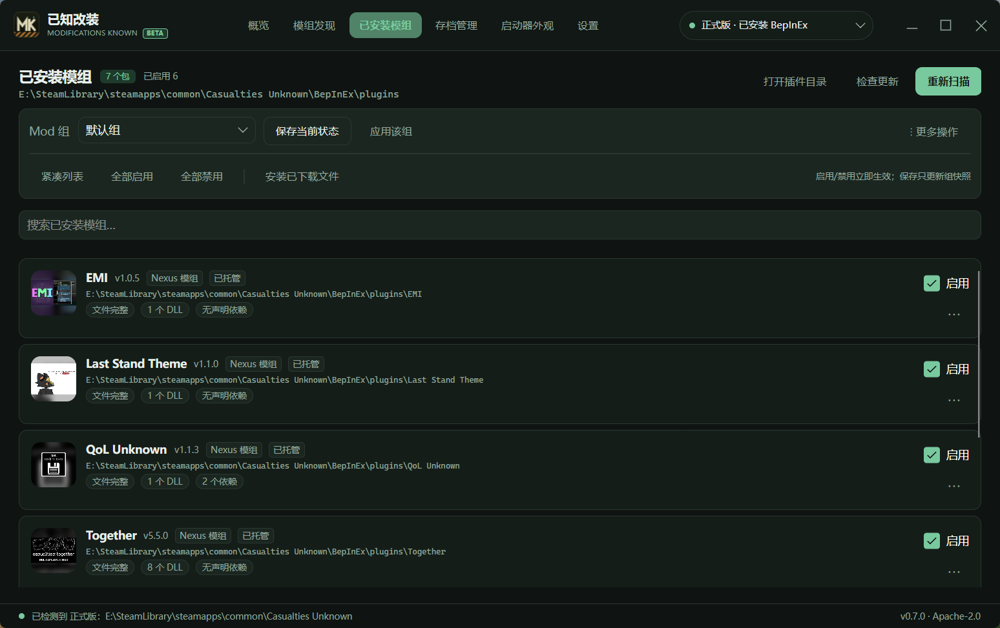
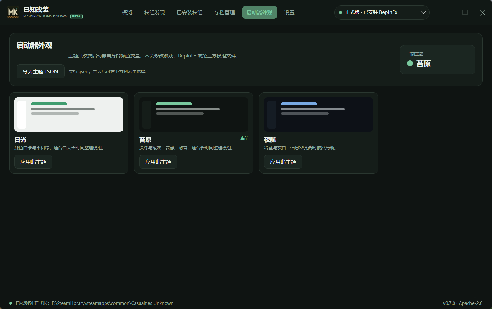
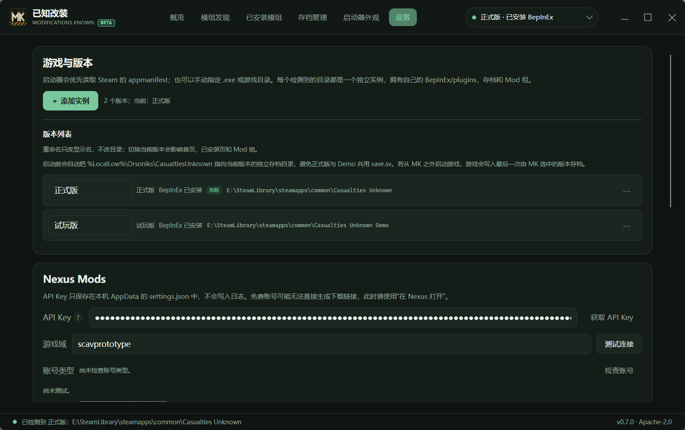

# 【Beta】已知改装 v0.7.0：给《未知伤亡》做一个安静的 BepInEx 模组管理器

> 省流：Windows 10/11 x64 免安装，GitHub / 蓝奏云双通道下载；Beta 版，请先备份存档。

《未知伤亡》的模组生态正在慢慢长起来，但装模组这件事依然不太轻松：

- 正式版和试玩版各有一套 BepInEx 和存档，切来切去容易混；
- 一个模组经常是“一个文件夹 + 好几个 DLL”，启停和卸载都得手动判断；
- 从 Nexus 下载、解压、覆盖、回滚，每一步都可能出错；
- 免费账号还会遇到 403，不知道该点哪里。

**已知改装（Modifications Known，简称 MK）** 就是为这些事做的。它不是要替你隐藏文件系统，而是把“找模组、装模组、更新模组、卸载模组”整理成一条完整、可解释的链路。

---

## 这个版本能做什么

### 正式版 / 试玩版，分开管

- 每个游戏目录都是一个独立实例，有自己的 `BepInEx/plugins`、Mod 组和存档 profile；
- 支持 Steam 正式版、试玩版同时存在，也支持手动选择 exe / 目录；
- 启动前自动切换对应实例的独立存档，避免两个版本共用 `save.sv`。

### 模组按“包”管理，而不是按 DLL 猜

- 扫描 `BepInEx/plugins`，递归识别嵌套 DLL；
- 一个文件夹视为一个模组包，多 DLL 模组整体启用 / 禁用 / 卸载；
- 安装时在包内写入 manifest，记录文件、哈希和 Nexus 来源；
- 按清单卸载只删除未修改的托管文件，保留你自己加的文件；
- 旧的手动模组可以“接管”，生成基线清单后再纳入管理。

### Nexus 浏览、下载、更新

- 搜索、详情、文件版本、下载、安装一条龙；
- 免费账号 403 时提供 NXM / 浏览器下载回退；
- 已安装页支持**检查更新、单项更新、一键更新**；
- 更新前可选备份旧包，跨盘也能备份；安装失败自动恢复旧目录；
- 更新完成后自动清除“可更新”徽标，不用再手动检查一遍。

### 卸载 BepInEx，也做成危险操作

- 实例 `⋯` 菜单新增“卸载 BepInEx…”；
- 两步确认：先勾选“我已知晓会删除该实例所有模组”，再等 5 秒最终确认；
- 会删除 `BepInEx/`、`winhttp.dll`、`doorstop_config.ini` 等加载器文件，以及该实例全部模组与配置。

### 外观与体验

- 苔原（默认）/ 日光 / 夜航三套主题；
- 支持导入 JSON 自定义主题；
- 自绘标题栏、BETA 标识、拖放安装、可滚动标题标签；
- 首页清单引导：实例 → BepInEx → API Key → NXM → 第一个模组；
- 发现页会标注“可能 Demo / 作者提到 Demo”，长标题不会遮住提示。

### 启动器自更新

- 设置页可检查 GitHub Release；
- 下载后校验 GitHub asset 的 SHA-256，匹配才替换；
- 当前进程退出后自动替换 exe 并重启。

> Beta 属于预发布，稳定版自更新通道不会自动推送；想更新 Beta 请手动下载。

---

## 界面预览

**概览页：实例状态、清单、最近活动、启动按钮**



**模组发现：搜索、详情、版本与更新日期**



**已安装模组：托管状态、依赖、启停与更新**



**启动器外观：苔原 / 日光 / 夜航**



**设置：实例、Nexus API Key、游戏域**



> B 站专栏上传图片时，可以直接保存上面的图片再上传；图片素材也在项目 `docs/images/` 目录。

---

## 下载

### 首选：GitHub Release

<https://github.com/HOPE-LGNF/modifications-known/releases/tag/v0.7.0-beta>

直接下载 exe：

<https://github.com/HOPE-LGNF/modifications-known/releases/download/v0.7.0-beta/ModificationsKnown-v0.7.0-beta-win-x64.exe>

### 备用：蓝奏云（GitHub 打不开时用）

<https://unauthhope.lanzout.com/iYnH04g2143g>

密码：`f1ka`

**系统要求：** Windows 10/11 x64  
**免安装**，不需要单独安装 .NET 运行时。

### 校验

```text
SHA-256:
aeba515098bd8f1318362efd9a664d85ba9093227351819b7c6adb90cb3d54f0
```

下载后建议核对哈希，确认一致再运行。  
除 GitHub 和上述蓝奏云外，请避免使用其他转载链接。

---

## 第一次使用

1. 解压或放到任意目录，运行 exe；
2. 设置 → 游戏与版本 → 添加游戏实例；
3. 在实例的 `⋯` 菜单里安装 BepInEx；
4. 设置 → Nexus Mods 填入 API Key；
5. 免费账号建议同时注册 NXM；
6. 到“模组发现”浏览安装，到“已安装模组”启停 / 更新。

需要控制台日志时：

```powershell
ModificationsKnown-v0.7.0-beta-win-x64.exe --console
```

日志会同时写入 `%APPDATA%\ModificationsKnown\logs\`。

---

## Beta 注意事项

- 这是 Beta，请先备份重要存档和模组配置；
- 未做代码签名，Windows SmartScreen 可能提示“未知发布者”；代码已开源，可自行审查，但仍建议核对 SHA-256，并只从官方 Release 或蓝奏云下载；
- 免费 Nexus 账号仍需要 NXM 或浏览器手动下载，MK 不能绕过 Nexus 403；
- 依赖图、冲突检测、崩溃归因、游戏内皮肤还没做；
- 模组卡片的“可能 Demo”是更新日期 + 作者文本的提示，不是兼容性保证；
- 启动器自更新已支持 SHA-256 校验，但 Beta 属于预发布，稳定版通道不会自动推送；目前仍有些地方不够稳定，请以手动更新为主。

---

## 反馈

遇到问题欢迎在评论区回复，尽量附上：

- 复现步骤；
- `--console` 的控制台输出；
- 相关截图。

请勿粘贴 Nexus API Key、账号信息或完整隐私路径。

项目地址：

<https://github.com/HOPE-LGNF/modifications-known>

Apache-2.0，欢迎 issue / PR。我可能不会秒回，但会不时查看。

---

## 备注

本项目由**大肥鱼**赞助播出（

感谢每一位帮忙测试、反馈和容忍 Beta 不稳定的人。  
如果这个工具能让你少在 `plugins` 文件夹里翻十分钟，它就值了。
